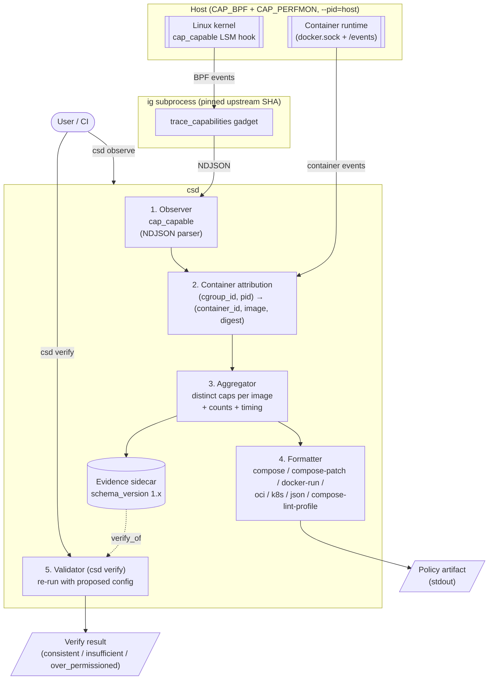
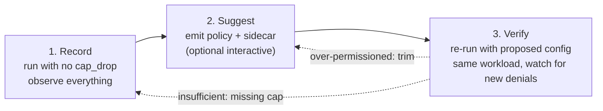
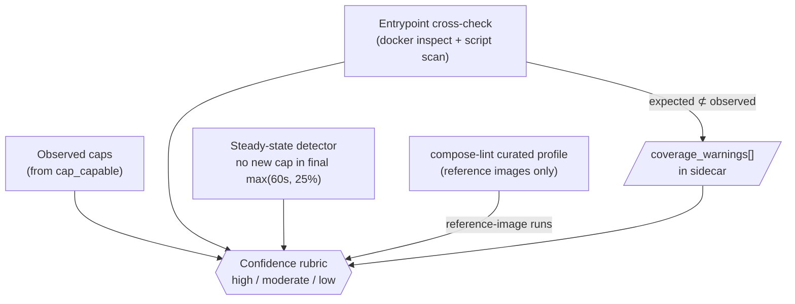
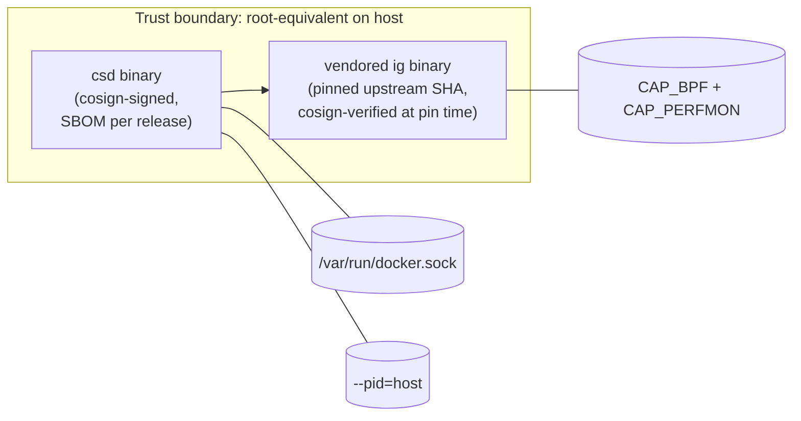

# Architecture diagram

Visual companion to [`PLAN.md` §Architecture](../PLAN.md#architecture). The plan is authoritative; this page is a map.

## Layered pipeline

`csd observe` is a four-layer pipeline. `csd verify` is a fifth layer that re-runs the pipeline against a proposed config.

**Why the layering matters.** v1 ships exactly one observer (`cap_capable`). v0.2+ adds siblings (`writable_path`, `device_open`, `socket_connect`, …) that plug into the same attribution + aggregator + formatter chain. Collapsing the layers to ship faster trades v0.2 for v0.1 weeks — it is load-bearing.

## Three-phase workflow

Borrowed from AppArmor's complain → enforce pattern.

Phases 1 and 2 ship in `csd observe`. Phase 3 is `csd verify`, a self-consistency check — not a sufficiency proof. Workload coverage is the ceiling on both.

## Workload-coverage cross-checks

Three signals run alongside observation to convert silent coverage gaps into loud warnings.

Confidence rubric definition lives in [`PLAN.md` §Confidence scoring](../PLAN.md#confidence-scoring) — this diagram only shows the inputs.

## Privilege & supply-chain posture

Every layer in the pipeline runs under the same blast radius.

See [`PLAN.md` §Tool posture](../PLAN.md#tool-posture) for the full threat model and [`PLAN.md` §Supply-chain](../PLAN.md#supply-chain) for the release path.
